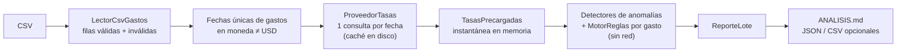

# Xpendit — motor de reglas de gastos

Solución en **Python 3.12+** al desafío técnico de Xpendit, en tres partes:

1. **Motor de reglas** ([`src/xpendit/domain/`](src/xpendit/domain/)): lógica pura que decide
   APROBADO, PENDIENTE o RECHAZADO según la política, sin red ni archivos.
2. **Cliente de tasas de cambio** ([`adapters/tasas/`](src/xpendit/adapters/tasas/)): Open
   Exchange Rates con timeout, reintentos, manejo de errores y caché.
3. **Analizador de lotes** (`python -m xpendit analizar`): procesa
   [`data/gastos_historicos.csv`](data/gastos_historicos.csv), detecta anomalías y genera
   [`ANALISIS.md`](ANALISIS.md).

## Resultado

Con tasas reales y fecha de referencia 2026-10-26: **8 APROBADOS, 18 PENDIENTES y 24 RECHAZADOS**.
Hay 7 grupos de duplicados exactos (5 entre personas distintas), ningún monto negativo, y bastan
**9 solicitudes** a la API para los 50 gastos (una por fecha única con moneda extranjera).

**Video (1 min) con los hallazgos:** <https://youtu.be/G5mJzLfoXdU>

## Quickstart

Requiere **Python 3.12+** y **Git**. Instalación detallada por sistema y solución de problemas:
[`docs/INSTALACION.md`](docs/INSTALACION.md).

<table>
<tr><th>macOS / Linux</th><th>Windows (PowerShell)</th></tr>
<tr><td>

```bash
git clone https://github.com/benjamintaito/Xpendit.git
cd Xpendit
python3 -m venv .venv
source .venv/bin/activate
python -m pip install -r requirements-dev.txt
python -m pytest -q
```

</td><td>

```powershell
git clone https://github.com/benjamintaito/Xpendit.git
cd Xpendit
py -3 -m venv .venv
.\.venv\Scripts\Activate.ps1
python -m pip install -r requirements-dev.txt
python -m pytest -q
```

</td></tr>
</table>

`requirements-dev.txt` instala las dependencias de ejecución (`requests`, `python-dotenv`), las
de desarrollo (`pytest`, `ruff`, `mypy`) y el propio paquete en modo editable.

## Configurar la API key

La key nunca va en el código: se lee de la variable de entorno `OXR_APP_ID`, que puede venir de
un archivo `.env` (ignorado por Git).

1. Crea una cuenta gratuita en <https://openexchangerates.org/signup/free> y copia tu App ID
   desde <https://openexchangerates.org/account/app-ids>.
2. Copia la plantilla: `cp .env.example .env` (macOS/Linux) o `copy .env.example .env` (Windows).
3. Edita `.env` y completa la línea `OXR_APP_ID=tu_app_id`.

Opcional: `OXR_TIMEOUT` (segundos por solicitud; por defecto 10). Una variable ya definida en el
entorno tiene prioridad sobre `.env`. El cliente envía la key en el header
`Authorization: Token …`, no en la URL, y nunca la imprime ni la registra en logs.

## Ejecutar el analizador

```bash
# Con la API real (requiere OXR_APP_ID): resultado oficial, 8/18/24
python -m xpendit analizar data/gastos_historicos.csv --fecha-referencia 2026-10-26

# Sin API key ni red: tasas fijas de ejemplo, da 8/17/25
python -m xpendit analizar data/gastos_historicos.csv --offline --fecha-referencia 2026-10-26
```

En Windows funcionan igual (con `data\gastos_historicos.csv` o con `/`). Ambos imprimen un
resumen y escriben `ANALISIS.md`; para no sobrescribir el versionado, agrega `--salida otro.md`
(o restáuralo con `git checkout -- ANALISIS.md`).

| Opción | Descripción |
|---|---|
| `CSV` | Ruta del CSV de gastos (posicional). |
| `--fecha-referencia AAAA-MM-DD` | Fecha contra la que se mide la antigüedad (por defecto, hoy). **El desglose depende de ella.** |
| `--offline` | Tasas fijas de ejemplo; no requiere API key ni red. |
| `--politica RUTA` | Política JSON (por defecto `config/politica.json`). |
| `--salida RUTA` | Reporte Markdown (por defecto `ANALISIS.md`). |
| `--json RUTA` / `--csv-salida RUTA` | Exporta además los resultados por gasto. |
| `--cache-dir RUTA` / `--sin-cache` | Caché en disco de tasas (por defecto `.cache/tasas`). |
| `-v` | Logs informativos (fechas consultadas, reintentos). |

**Por qué `--offline` da 8/17/25.** Usa tasas redondas (900 CLP, 17,5 MXN y 0,92 EUR por USD).
Con 900 CLP, `g_006` (144 000 CLP) vale 160 USD y se rechaza; con la tasa real de ese día
(960,57) vale 149,91 USD, 9 centavos bajo el máximo de 150 de `food`, y queda PENDIENTE.

Los errores esperables (falta la key, política o CSV inválidos, key rechazada, cuota agotada)
terminan con código 2 y un mensaje claro, sin traceback. Una fila inválida del CSV no detiene el
lote: se reporta en `ANALISIS.md`. Las tasas de días cerrados se guardan en `.cache/tasas/`, así
que una segunda corrida no hace solicitudes HTTP.

## Tests y calidad

```bash
python -m pytest -q          # 413 tests sin Internet (fuera de Windows se omite 1)
python -m pytest --cov       # cobertura: 99 % total, 100 % en el dominio
python -m ruff check .
python -m ruff format --check .
python -m mypy               # modo strict
```

`python tareas.py check` corre lint, tipos y tests en cualquier sistema (`python tareas.py
--help` lista los demás atajos). La [CI](.github/workflows/ci.yml) corre los tests y el
analizador en Linux, Windows y macOS con Python 3.12 y 3.13.

| Carpeta | Qué cubre |
|---|---|
| `tests/domain/` | Cada regla en sus bordes (días 30/31 y 60/61, fecha futura; food 100/100,01 y 150/150,01; transport 200/200,01; core_engineering + food), conversión, resolución de estado, los ejemplos JSON del enunciado y una regla nueva sin tocar el motor. |
| `tests/adapters/` | Cliente OXR (errores de la API, reintentos, timeout, la key fuera de mensajes y logs, camino HTTP real contra un servidor local), caché, lector CSV, política y reporte. |
| `tests/application/` | Caso de uso: N gastos en K fechas únicas → exactamente K consultas; fallas por fecha y fatales. |
| `tests/test_*.py` | CLI de punta a punta, composición y `tareas.py`, incluida la consola de Windows. |

## Arquitectura

Hexagonal: el dominio no hace I/O y no depende de nada fuera de la biblioteca estándar; los
adaptadores implementan sus puertos y [`composicion.py`](src/xpendit/composicion.py) es el único
lugar que los instancia. Flujo de un lote:



```
src/xpendit/
├── cli.py, composicion.py, __main__.py
├── domain/        # sin I/O
│   ├── modelos.py, politica.py, errores.py
│   ├── reglas/    # antigüedad, conversión de moneda, límite por categoría, centro de costo
│   ├── motor.py, resolucion.py
│   ├── anomalias.py
│   └── tasas.py   # puerto ProveedorTasas, ConversorMoneda, TasasPrecargadas
├── application/   # caso de uso AnalizarLote, puerto LectorGastos, agregaciones del reporte
└── adapters/
    ├── csv_gastos.py, politica_json.py
    ├── tasas/     # open_exchange_rates.py, cache.py, fijas.py (offline)
    └── reporte/   # markdown.py, exportar.py (JSON y CSV)
```

## Cómo extender

- **Regla:** una clase con `nombre` y `evaluar(gasto, empleado, contexto) -> ResultadoRegla | None`
  (`None` = no aplica), agregada a `reglas_por_defecto()` en
  [`domain/reglas/__init__.py`](src/xpendit/domain/reglas/__init__.py). El motor no cambia; un
  test lo demuestra con una regla de fin de semana.
- **Anomalía:** una clase con `codigo`, `estado` y `detectar(gastos) -> dict[gasto_id, list[Alerta]]`,
  agregada a `detectores_por_defecto()` en [`anomalias.py`](src/xpendit/domain/anomalias.py).
  Entra en la misma resolución de estado.
- **Proveedor de tasas:** implementar `obtener_tasas(fecha) -> Mapping[str, Decimal]` y elegirlo en
  `composicion.construir_fuente_tasas`; se puede envolver con `ProveedorTasasConCache`.
- **Fuente de gastos:** implementar el puerto `LectorGastos` (`leer() -> LoteLeido`), p. ej. desde
  una base de datos, y pasarlo a `AnalizarLote.ejecutar`.

## Supuestos

Detalle y alternativas en [`docs/DECISIONES.md`](docs/DECISIONES.md).

- Estado final: RECHAZADO > PENDIENTE > APROBADO; si ninguna regla aplica, PENDIENTE sin alertas.
- Antigüedad en días calendario hasta la fecha de referencia, con umbrales inclusivos. Fecha
  futura → PENDIENTE con `FECHA_FUTURA`.
- Límites comparados en USD con la tasa del día del gasto, redondeada a centavos. Categoría sin
  límite → la regla no aplica.
- Moneda o fecha sin tasa → al menos PENDIENTE con `TASA_NO_DISPONIBLE`.
- Duplicado = mismo monto, moneda y fecha (definición del enunciado): el primero del archivo es
  el original y las copias quedan al menos PENDIENTE.
- Monto negativo o cero → RECHAZADO con `MONTO_INVALIDO`.

## Entregables

| Requisito del enunciado | Dónde |
|---|---|
| Parte 1: modelos `Gasto`, `Empleado`, `Politica` | [`domain/modelos.py`](src/xpendit/domain/modelos.py), [`domain/politica.py`](src/xpendit/domain/politica.py), [`config/politica.json`](config/politica.json) |
| Parte 1: reglas y resolución de estado | [`domain/reglas/`](src/xpendit/domain/reglas/), [`motor.py`](src/xpendit/domain/motor.py), [`resolucion.py`](src/xpendit/domain/resolucion.py) |
| Parte 1: resultado `{gasto_id, status, alertas}` | `ResultadoValidacion.a_dict()` en [`modelos.py`](src/xpendit/domain/modelos.py) |
| Parte 1: tests unitarios | [`tests/domain/`](tests/domain/) |
| Parte 2: cliente de Open Exchange Rates | [`open_exchange_rates.py`](src/xpendit/adapters/tasas/open_exchange_rates.py), [`cache.py`](src/xpendit/adapters/tasas/cache.py) |
| Parte 3: analizador de lotes | [`cli.py`](src/xpendit/cli.py), [`application/analizar_lote.py`](src/xpendit/application/analizar_lote.py) |
| Parte 3: duplicados exactos y montos negativos | [`domain/anomalias.py`](src/xpendit/domain/anomalias.py) |
| Parte 3 (bonus): una consulta por fecha única | `AnalizarLote` y [`tests/application/`](tests/application/) |
| `ANALISIS.md` | [`ANALISIS.md`](ANALISIS.md) |
| Video de hasta 1 minuto | [Ver en YouTube](https://youtu.be/G5mJzLfoXdU) |
| README: instalación, API key, tests, analizador | Este archivo y [`docs/INSTALACION.md`](docs/INSTALACION.md) |
| Extras | [`docs/DECISIONES.md`](docs/DECISIONES.md), [`docs/USO_DE_IA.md`](docs/USO_DE_IA.md), [`tareas.py`](tareas.py), [CI](.github/workflows/ci.yml) |
